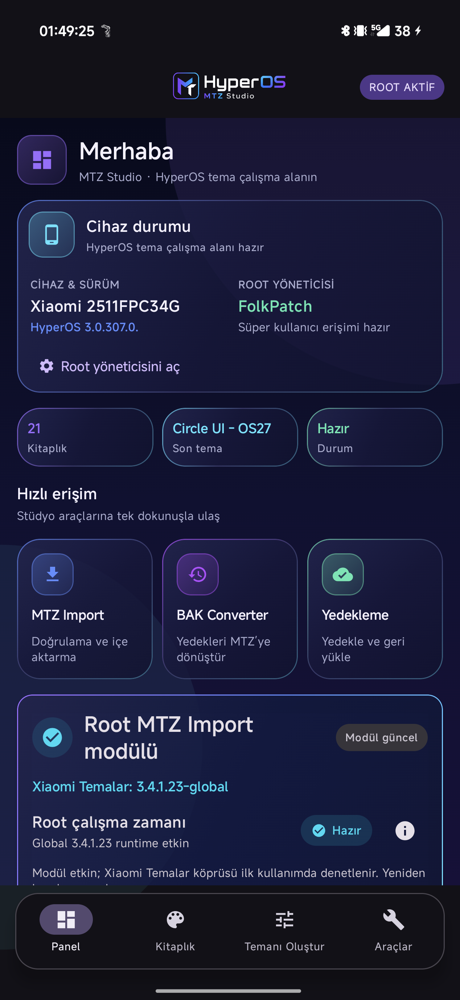
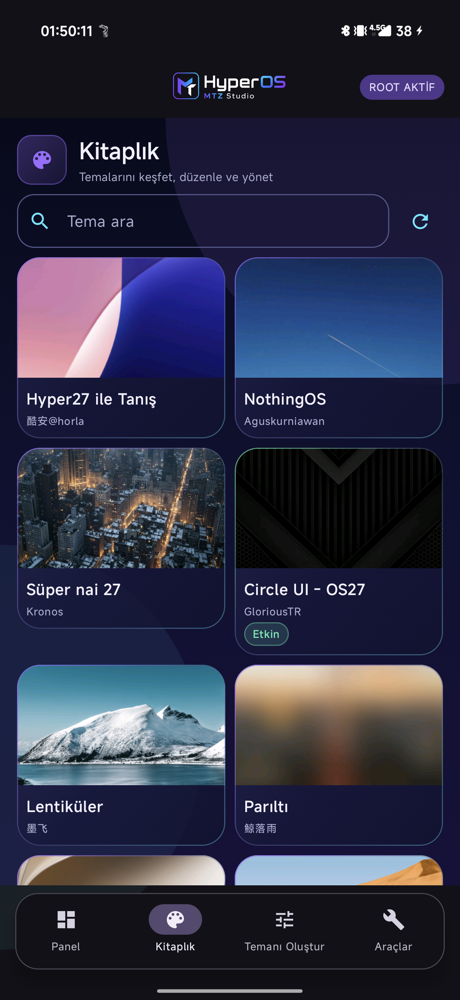
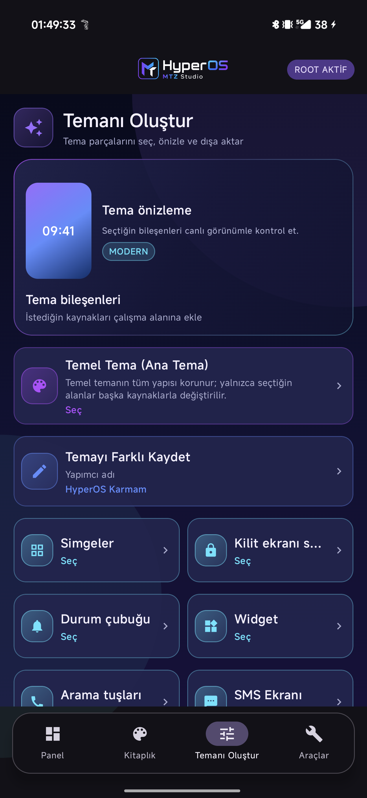
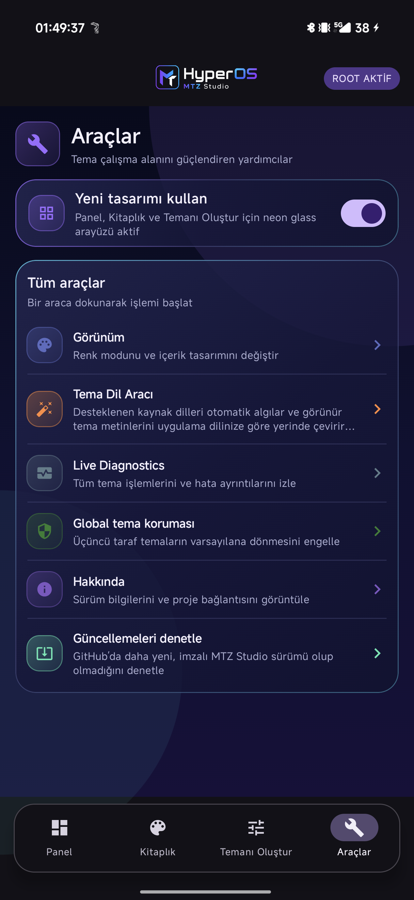
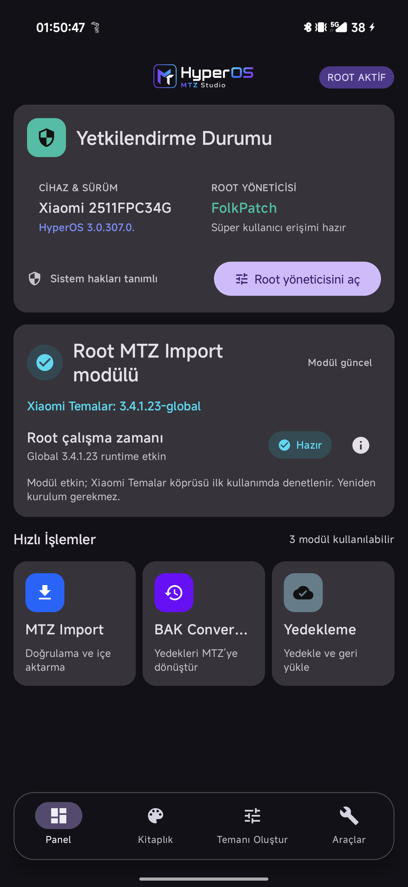
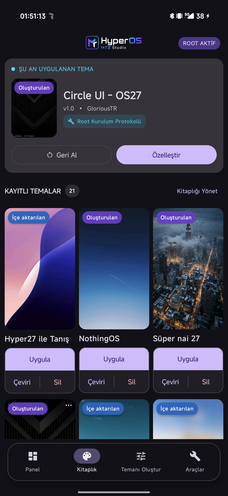
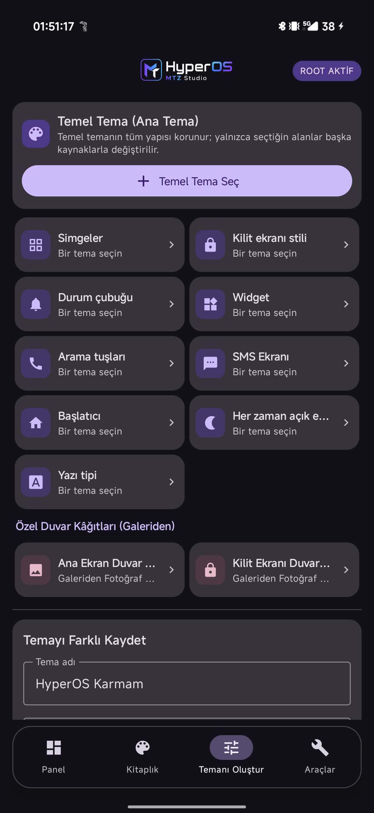
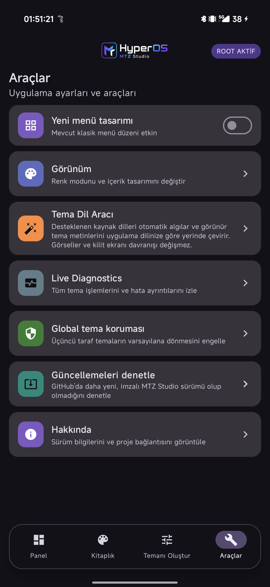

# HyperOS MTZ Studio

<p align="center">
  
</p>

<p align="center">
  Xiaomi HyperOS için açık kaynaklı MTZ çalışma alanı.<br>
  Temaları içe aktarın, düzenleyin, çevirin, dönüştürün, birleştirin ve uyumlu cihazlarda uygulayın.
</p>

<p align="center">
  <strong>🇹🇷 Türkçe</strong> · <a href="readme_en.md">🇬🇧 English</a>
</p>

<p align="center">
  <a href="https://github.com/GloriousApps/HyperOS-MTZ-Studio/releases/latest"></a>
  <a href="https://github.com/GloriousApps/HyperOS-MTZ-Studio/actions/workflows/release.yml"></a>
  
</p>

<p align="center">
  <a href="https://github.com/GloriousApps/HyperOS-MTZ-Studio/releases/tag/v5.6.0"><strong>v5.6.0 APK indir</strong></a>
  · <a href="docs/release-notes-v5.6.0.md">Sürüm notları</a>
  · <a href="docs/theme-manager-compatibility.md">Uyumluluk</a>
  · <a href="https://github.com/GloriousApps/HyperOS-MTZ-Studio/issues">Sorun bildir</a>
</p>

## v5.6 arayüzü

### Yeni neon tasarım
<p align="center">
  
  
  
  
</p>

### Klasik tasarım
<p align="center">
  
  
  
  
</p>

## Neler yapar?

- **Dört menülü çalışma alanı:** Panel, Kitaplık, Temanı Oluştur ve Araçlar ekranları; klasik görünüme dönülebilen yeni bir navigasyon düzeniyle sunulur.
- **Panel hızlı işlemleri:** MTZ Import, BAK Converter ve Yedekleme işlemleri tek satırda erişilebilir. Root runtime durumu teknik ayrıntıları ana ekranı kalabalıklaştırmadan gösterir.
- **Kitaplık koleksiyonu:** İki sütunlu büyük önizlemeler ve Tümü, Oluşturulan, İçe aktarılan filtreleriyle temalar daha hızlı bulunur.
- **Kompozisyon akışı:** Temanı Oluştur ekranı seçilen bölümleri, toplam ilerlemeyi ve bileşen seçim durumunu canlı gösterir.
- **MTZ Import:** MTZ paketlerini doğrular, özel kitaplığa ekler ve önizleme verilerini üretir. Tek dosya veya en fazla beş dosyalı toplu içe aktarma kullanılabilir. Desteklenen modern Xiaomi Temalar sürümlerinde tema Xiaomi kitaplığına da aktarılır.
- **BAK Converter:** Desteklenen Xiaomi Temalar `.bak` yedeklerini güvenli biçimde MTZ’ye dönüştürür; sonuç doğrudan kitaplığa gelir.
- **Tema Dil Aracı:** Görünür tema metinlerini uygulama diline göre çevirir. XML, JSON ve güvenli MAML içerikleri için çeviri belleği ve isteğe bağlı API sağlayıcıları kullanır. Çeviri tamamlandığında eski Xiaomi kitaplığı kopyası geçersiz kılınır ve güncel MTZ desteklenen Shizuku/Shevery akışında yeniden eşitlenir.
- **Temanı Oluştur:** Bir temel temaya başka paketlerden kilit ekranı, simgeler, durum çubuğu, `clock_2x4` widget’ı, yazı tipi, duvar kâğıdı ve diğer seçili bileşenleri ekleyerek yeni MTZ oluşturur. Her seçicide yalnız ilgili bileşeni gerçekten içeren temalar görünür ve kart yüksekliği önizleme olsa da olmasa da sabit kalır. Oluşturulan tema, desteklenen modern Xiaomi Temalar sürümlerinde yerel kitaplığa da hazırlanır.
- **Kitaplık:** Uygulanan temayı, içe aktarılan ve oluşturulan temaları font paketlerinden ayrı gösterir. Kitaplığı Yönet ekranı çoklu seçimle silme ve desteklenen cihazlarda Xiaomi Temalar’dan yerel tema alma imkânı sunar.
- **Yedekleme ve güncelleme:** Studio kitaplığı için bulut/WebDAV yedekleme ve geri yükleme sunar. Her ön plana gelişte GitHub güncellemesini arka planda denetler; yeni sürümü bildirir ve doğrulanmış APK indirmesini yüzde ilerlemesiyle gösterir.
- **Live Diagnostics:** İçe aktarma, dönüştürme, çeviri ve uygulama adımlarını kaydeder; Temalar paketiyle ilgili sorunların incelenmesini kolaylaştırır.

### Root MTZ Import Modülü 2.0.0 ve Theme Manager V7

Root bulunan, ancak Xiaomi Temalar içinde yerel MTZ içe aktarma yolu olmayan cihazlarda Studio, **GloriousApps** imzalı Root MTZ Import Modülü `2.0.0` sürümünü uygulama içinden kurar veya günceller. Modül APK'yı değiştirmez ya da yeniden imzalamaz; Xiaomi Temalar'ın doğrulanmış yerel içe aktarma ve uygulama akışını etkinleştirir. Global bridge kurulumu sonrası yeniden başlatma gerekebilir. Global `3.4.1.23-global` ve Non-Global `11.5.3.1` runtime’ları desteklenir.

Cihazda geçerli Mods-Center Theme Manager V7 modülü ve Themes `11.5.3.1` runtime’ı varsa Studio bunu algılar, mevcut kurulumu benimser ve kendi Themes APK’sının üzerine yazmaz. Tema uygulaması modern Xiaomi Themes yerel kitaplık yolu üzerinden sürdürülür.

## Erişim modları

| Mod | Kullanım |
| --- | --- |
| **Root** | Algılanan root yöneticisi üzerinden gelişmiş Tema Yöneticisi işlemleri, uyumlu uygulama akışı ve tanılama. Geçerli V7 runtime varsa mevcut kurulum korunur. |
| **Shizuku / Shevery** | Root olmadan BAK Converter, yerel MTZ işlemleri, tema koruması ve desteklenen uygulama akışı. |
| **Yetkilendirme yok** | MTZ kitaplığı, önizleme, çeviri, besteci, dışa aktarma ve yedekleme kullanılabilir. Tema uygulama için Shizuku veya Shevery gerekir. |

Rootsuz cihazlarda Shizuku ya da [Shevery](https://github.com/HmnDev-Tech/shevery/releases) kurup Kablosuz hata ayıklama ile başlatın ve MTZ Studio iznini verin. Uygulama, kurulu yöneticiyi otomatik algılar ve gereken hizmeti açar.

## Tema Yöneticisi uyumluluğu

Studio yalnızca sabit bir Temalar sürüm listesine güvenmez. Eski Global sürümlerde `ApplyThemeForScreenshot` etkinliğini; modern sürümlerde yerleşik yerel tema kitaplığı ekranını ve runtime doğrulamasını çalışma anında kontrol eder. Xiaomi Themes `3.4.1.23-global` ve `11.5.3.1` runtime aileleri desteklenir. Geçerli Theme Manager V7 kurulumu varsa mevcut runtime benimsenir ve üzerine yazılmaz.

Bu seçenek, doğrulanmış Xiaomi Themes `3.0.5.6-global` paketini uygulama içinden Android İndirme Yöneticisiyle doğrudan indirir:

- [Xiaomi Themes 3.0.5.6-global APK](https://raw.githubusercontent.com/GloriousApps/HyperOS-MTZ-Studio/main/requirements/Xiaomi_Themes_3.0.5.6-global.apk)
- [SHA-256 doğrulama dosyası](https://raw.githubusercontent.com/GloriousApps/HyperOS-MTZ-Studio/main/requirements/Xiaomi_Themes_3.0.5.6-global.apk.sha256)

Xiaomi son uygulama ekranını ve tema kabul davranışını ROM’a göre değiştirebilir. Studio, uygulama sonuçlarını ve uyumluluğu mümkün olduğunda çalışma anında doğrular; manuel Xiaomi onayı yine görünebilir.

## Kurulum

1. [v5.6.0 Release](https://github.com/GloriousApps/HyperOS-MTZ-Studio/releases/tag/v5.6.0) sayfasından `MTZ_Studio_v5.6.0.apk` dosyasını indirin.
2. Eski bir sürümden geçiyorsanız önemli Studio kitaplığınızı yedekleyin.
3. APK’yı kurun, uygulamayı açın ve erişim modunun algılanmasını bekleyin.
4. Rootsuz tema uygulama için Shizuku/Shevery iznini verin.

v2.1.0 ve sonrasındaki resmi sürümler aynı imza anahtarını kullanır; normalde mevcut kurulumun üzerine güncellenir. Android, APK kurulumunun son onayını her zaman kullanıcıdan ister.

## Geliştirme

Gereksinimler: JDK 17, Android SDK API 36 ve Android 8.0 / API 26 veya üzeri.

```powershell
.\gradlew.bat test assembleDebug
```

Release imzalama için `MTZ_RELEASE_STORE_FILE`, `MTZ_RELEASE_STORE_PASSWORD`, `MTZ_RELEASE_KEY_ALIAS` ve `MTZ_RELEASE_KEY_PASSWORD` değişkenleri kullanılır.

## Belgeler

- [Mimari](docs/architecture.md)
- [Tema Yöneticisi uyumluluğu](docs/theme-manager-compatibility.md)
- [Yerelleştirme](docs/localization.md)
- [Tema Dil Aracı](docs/theme-language-translation.md)
- [Gizlilik ve güvenlik modeli](docs/threat-model.md)

## Sorumlu kullanım

Tema, font, simge ve görselleri yalnızca sahibi olduğunuz veya kullanım izniniz bulunan paketlerde kullanın. Xiaomi ve HyperOS ilgili sahiplerinin ticari markalarıdır. Bu bağımsız proje Xiaomi ile bağlantılı değildir ve Xiaomi tarafından desteklenmez.

<p align="center">
  HyperOS kullanıcıları ve tema üreticileri için <a href="https://github.com/GloriousApps">GloriousApps</a> tarafından geliştirildi.
</p>
